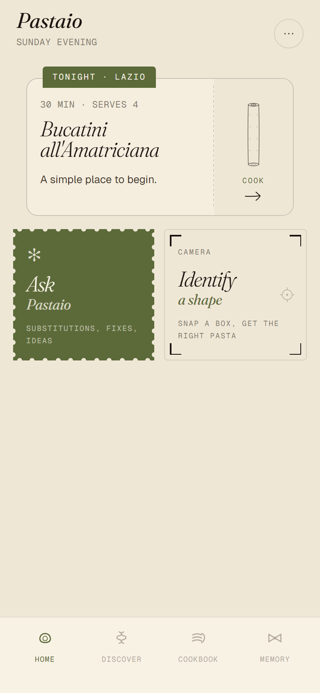
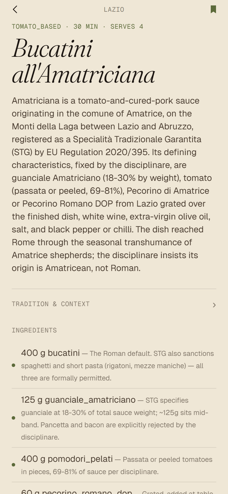
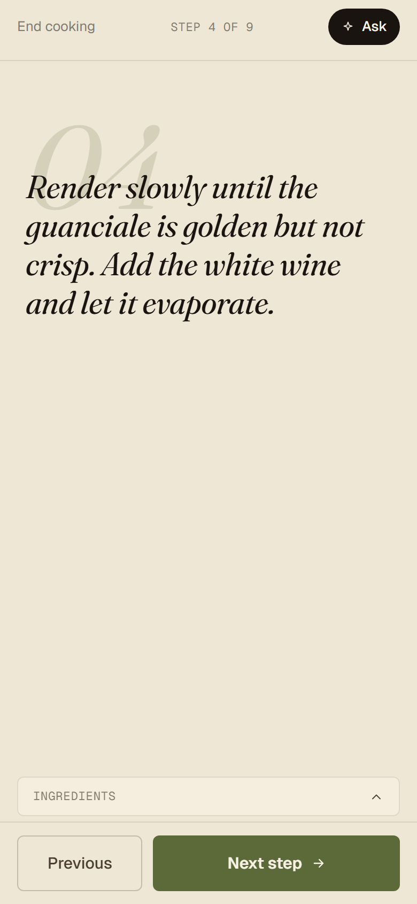
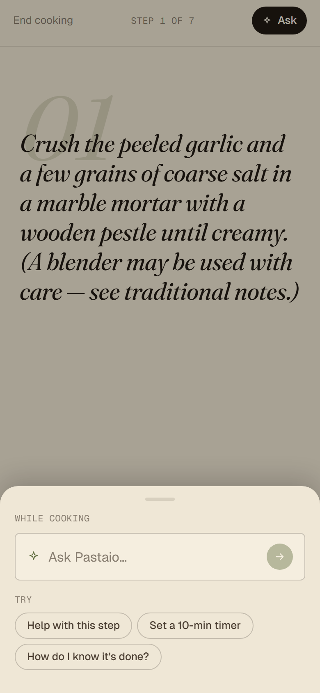
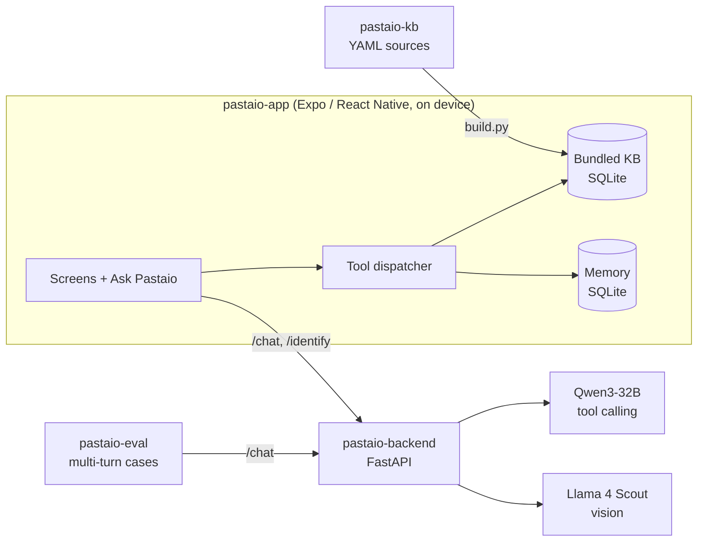

<p align="center"></p>

<h1 align="center">Pastaio</h1>

<p align="center"><b>An Italian pasta-cooking app with an LLM agent that acts through the same tools as the buttons.</b></p>

<p align="center">
  
  
  
  
</p>

Browse recipes, identify a pasta shape from a photo, and cook step by step. From any screen, "Ask Pastaio" hands the request to an agent that can open recipes, apply ingredient substitutions, set timers and save to the cookbook. It acts on the same app state the buttons drive, and it answers from a curated recipe knowledge base with sources, not from the model's memory.

Principle: *reasoning in the cloud, state and action on the device.*

<details>
<summary>Walk-through (17 s GIF): splash, home, discover, a recipe, cooking steps</summary>
<p align="center"></p>
</details>

*Captured from the web build with the offline stub backend; the app targets iOS and Android through Expo.*

## Architecture


| Folder | What it is |
|---|---|
| `pastaio-app/` | Expo SDK 54, React Native, TypeScript, Zustand. Screens, the tool dispatcher, on-device SQLite for the KB and the user's memory. |
| `pastaio-backend/` | FastAPI + Pydantic v2. `/chat` (agent with tool calls), `/identify` (pasta shape from a photo), `/kb/recipes` (debug). Backends: Groq, Ollama or a stub. Dockerfile included. |
| `pastaio-kb/` | 18 recipes plus regions, shapes, sauces and substitutions as YAML, validated and compiled to SQLite by `build.py`. Sourcing rules in `RESEARCH_PRINCIPLES.md`. |
| `pastaio-eval/` | Multi-turn eval harness: runs cases against `/chat` and mirrors the app's dispatcher in Python, so no phone is needed. |

## Run it
Python 3.11+ and Node 18+.

```bash
# 1. Knowledge base
cd pastaio-kb && python build.py && cp pastaio-kb.db ../pastaio-app/assets/ && cd ..

# 2. Backend (stub needs no API key; use groq or ollama for real answers)
cd pastaio-backend && pip install -e ".[dev]"
export PASTAIO_REASONING_BACKEND=stub PASTAIO_VISION_BACKEND=stub   # see ../.env.example
uvicorn app.main:app --reload --host 0.0.0.0 && cd ..

# 3. App
cd pastaio-app && npm install && npx expo start
```

The app reads the backend URL from `extra.backendUrl` in `pastaio-app/app.json`. `localhost` works for the web build and emulators; for Expo Go on a phone, set it to your computer's LAN IP.

Media: `docs/media/capture-scripts/` re-records the screenshots and GIFs with Playwright against the web build (`PASTAIO_WEB_CAPTURE=1 npx expo start --web`).

Tests: `cd pastaio-backend && pytest` (the Ollama integration test needs a running Ollama).
Eval: `cd pastaio-eval && pip install -e . && python run_eval.py --backend http://localhost:8000` (needs `GROQ_API_KEY`).

## Limitations
- Small knowledge base: 18 recipes.
- The agent depends on a hosted model (Groq free tier) for good results; local Ollama models are smaller and weaker.
- The app's one unit test file has no test runner configured yet.

## License
Code: MIT (see `LICENSE`). Fonts: Fraunces and Geist, both under the SIL Open Font License. Recipe facts and citations come from institutional Italian sources (Mipaaf, Accademia Italiana della Cucina, EU regulations), credited per recipe.
