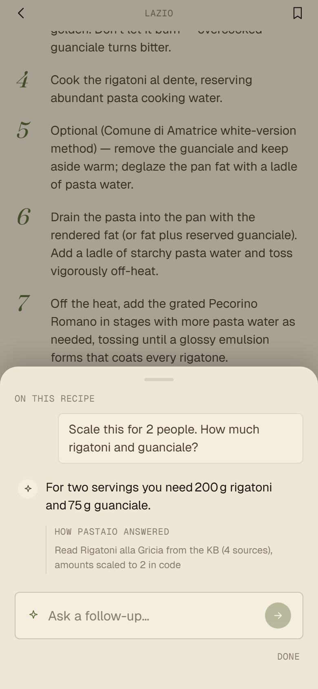
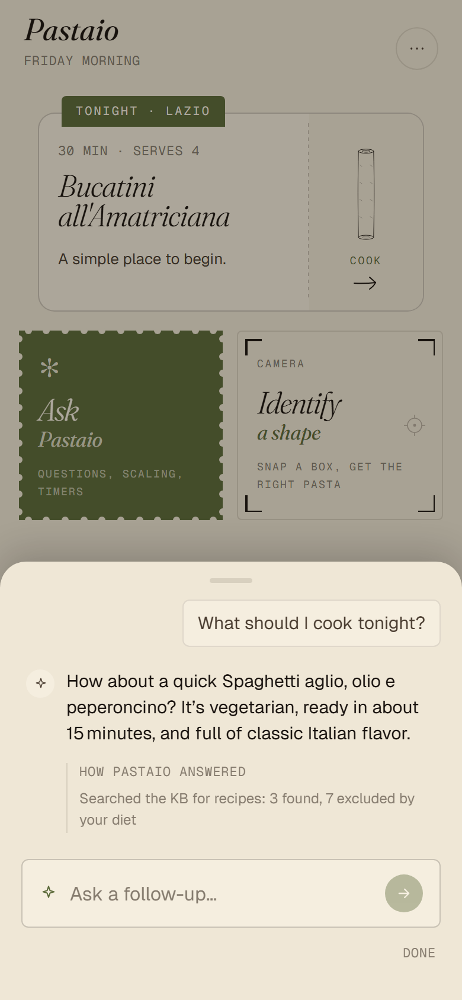
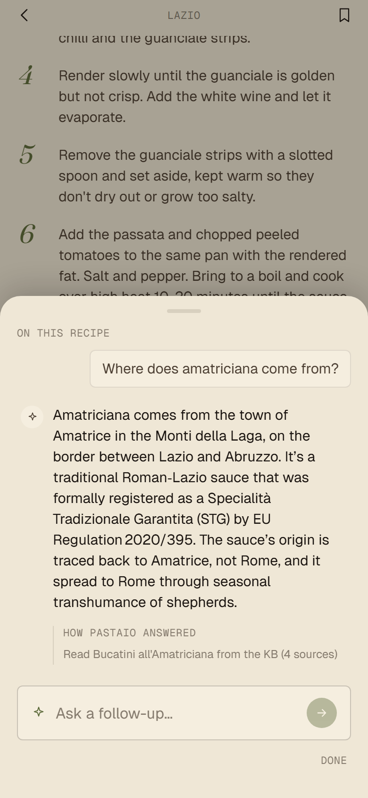
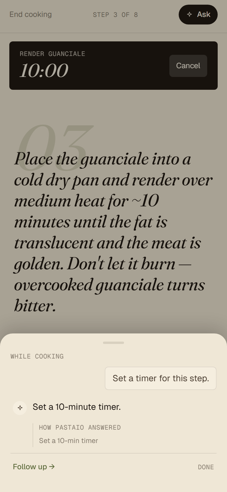
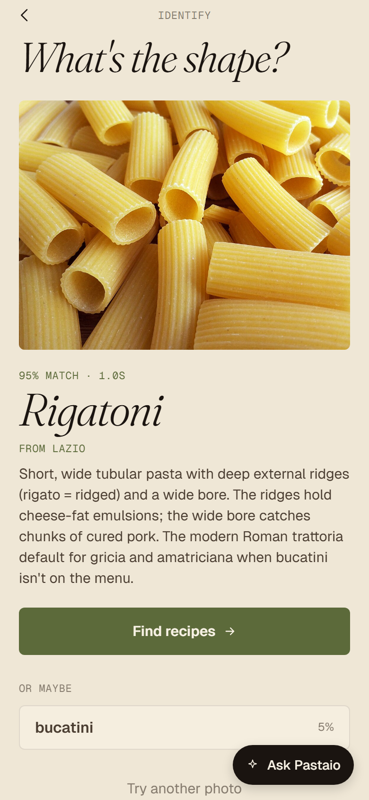
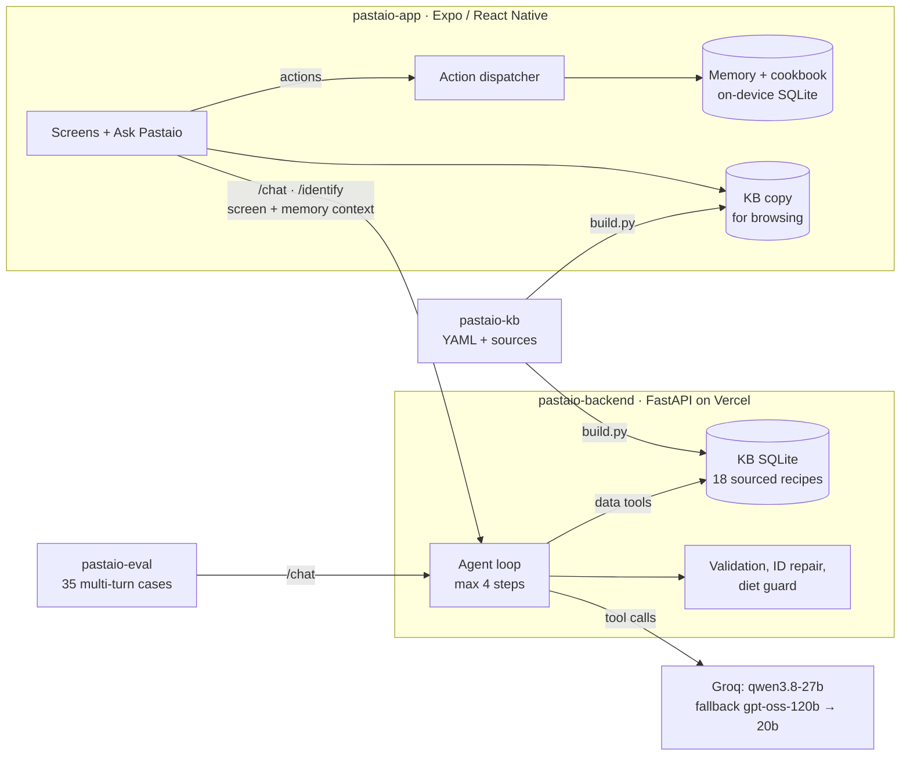

<p align="center"></p>

<h1 align="center">Pastaio</h1>

<p align="center"><b>An Italian pasta-cooking app with a tool-calling LLM agent. It answers from a sourced recipe knowledge base, and the rules that must not break are enforced in code.</b></p>

<p align="center">
  <a href="#guaranteed-in-code-not-by-the-model">What the code guarantees</a> ·
  <a href="#design-decisions">Design decisions</a><br><br>
  <a href="https://github.com/leventestaub/pastaio/actions/workflows/ci.yml"></a>
</p>

<p align="center">
  <br>
  <sub>Recorded against the real backend: photo → shape → recipe → "scale this for 2" → cooking questions → timer. Only the model waits are sped up (6×).</sub>
</p>

Each answer shows the question, the reply and, under "How Pastaio answered", what the backend actually did that turn (from the agent trace). Every shot below is one exchange with the real backend, and each shows one rule the code enforces:

| | | |
|---|---|---|
|  |  |  |
| **Scaling** is computed in code; the model only reports the numbers. | **Dietary restrictions** filter the search in code before the model sees the results. | **Facts** come from the KB record and its sources, not from the model's memory. |
|  |  | |
| **Actions** (here a timer, its length from the step in the KB) run in the app through the same dispatcher as the buttons. | **Shape ID** from a photo, with the runner-up shapes to pick from. | |

You photograph a pasta shape, and a vision model identifies it. You then pick a dish and cook it step by step. On any screen you can ask Pastaio something, for example "scale this for two", "how do I know the guanciale is done?", "I'm vegetarian" or "set a timer for that".

The agent looks up the answer in a curated knowledge base (18 recipes, each fact tied to an institutional Italian source) and acts through the same tools the buttons use. It can open a recipe, start cooking, set a timer, save to the cookbook or remember a dietary restriction. If the knowledge base doesn't record something, the agent says so instead of guessing.

It is built with Expo, so the same code targets the web, iOS and Android. There is no public demo; [Run it](#run-it) starts it locally.

## Architecture


A turn works like this:
1. The app sends the message together with its context: the current screen, the active recipe and step, running timers, dietary restrictions, and observations the agent noted earlier.
2. The backend runs the agent loop. The model only sees the tools that make sense on the current screen.
3. Data tools (`find_recipes`, `get_recipe_details`, `get_substitution_options`) run on the server against the KB, and their results go back to the model.
4. Action tools (`open_recipe`, `set_timer`, `save_to_cookbook` and 8 more) are validated and returned to the app. The app runs them through the same dispatcher the buttons use.

Principle: *reasoning in the cloud, state and action on the device.*

| Folder | What it is |
|---|---|
| `pastaio-app/` | Expo SDK 54, React Native, TypeScript, Zustand, expo-router. Screens, the action dispatcher, and on-device SQLite for memory and the cookbook. Also builds for the web. |
| `pastaio-backend/` | Python 3.11+, FastAPI, Pydantic v2. `/chat` runs the agent loop, `/identify` handles the photo, `/kb/recipes` is for debugging. LLM backends: Groq, Ollama or an offline stub. Deployed on Vercel; a Dockerfile is included. |
| `pastaio-kb/` | Recipes, regions, shapes, sauces and ingredient classes as YAML. `build.py` validates them with Pydantic and compiles them to SQLite. Sourcing rules are in `RESEARCH_PRINCIPLES.md`. |
| `pastaio-eval/` | An evaluation harness. It runs multi-turn conversations against `/chat`, mirrors the app's dispatcher in Python so no phone is needed, and scores each turn against assertions. |

## Guaranteed in code, not by the model
A prompt can ask the model to behave, but it can't make it. The behaviours below are therefore enforced in the backend and covered by tests that run in CI without any model:

| Guarantee | Where | Test |
|---|---|---|
| Dietary restrictions fail closed: an ingredient is safe only if its class is known to be compatible. Searches drop conflicting recipes, and if every match conflicts, the agent is told to say so. | `app/services/diet.py`, `chat_service.py` | [`test_diet.py`](pastaio-backend/tests/test_diet.py), [`test_all_matches_excluded_says_so`](pastaio-backend/tests/test_agent.py) |
| A substitution that breaks a restriction (pancetta for a vegetarian, say) is blocked before it reaches the app. | `chat_service._diet_block` | [`test_substitution_that_breaks_a_restriction_is_blocked`](pastaio-backend/tests/test_agent.py) |
| Opening a conflicting recipe is allowed, but the agent has to warn the user which ingredients conflict. | `chat_service._ack` | [`test_opening_a_conflicting_recipe_is_allowed_but_flagged`](pastaio-backend/tests/test_agent.py) |
| The agent can't claim the KB lacks something without checking. An answer like "the KB doesn't record that" with no lookup in the turn is sent back once, and the model has to look it up first. | `chat_service.py` | [`test_abstaining_without_a_lookup_is_sent_back_once`](pastaio-backend/tests/test_agent.py) |
| The agent can't list dishes the KB doesn't have. If every search in the turn came back empty and the answer still lists dishes, it is sent back once; on the last step it is replaced by what the KB does cover. | `chat_service._invented_dishes` | [`test_dishes_listed_after_an_empty_search_are_sent_back_once`](pastaio-backend/tests/test_agent.py) |
| Every tool call is validated against a Pydantic schema. An invalid call gets one repair attempt with the error fed back. A second failure is never returned to the app. | `app/schemas/tools.py`, `chat_service.py` | [`test_invalid_call_gets_one_repair_attempt`](pastaio-backend/tests/test_agent.py), [`test_tools.py`](pastaio-backend/tests/test_tools.py) |
| Hallucinated recipe IDs (`trofie-pesto-genovese`) are resolved to the one real ID they match, or rejected. | `kb.resolve_recipe_id` | [`test_resolve_recipe_id`](pastaio-backend/tests/test_kb.py) |
| The loop is bounded: at most 4 model calls per turn, and the last one has no tools, so it must answer in text. | `chat_service.py` | [`test_step_limit`](pastaio-backend/tests/test_agent.py) |
| The KB the server queries is the KB in the YAML sources. CI fails if the committed database is stale. | `pastaio-kb/build.py` | [`test_committed_db_matches_yaml_sources`](pastaio-backend/tests/test_kb.py) |
| When a model's quota runs out, or Groq keeps rejecting its tool calls, the client falls back to the next model in the chain. It waits only for short per-minute limits. | `app/clients/groq_client.py` | [`test_groq_client.py`](pastaio-backend/tests/test_groq_client.py) |
| The public backend is rate-limited, CORS-restricted and caps upload size. A quota error comes back as a clean 503. | `app/main.py`, `app/api/identify.py` | [`test_public_demo.py`](pastaio-backend/tests/test_public_demo.py) |

## Design decisions
- **The agent can only reach structured tools, no free-text retrieval.** 18 recipes fit in a SQLite file, and the questions are structured: which shape, which ingredient, which step. Typed lookups give exact numbers and sources, and they are easy to test. A vector store would add a dependency and fuzzier answers without making anything better at this size.
- **Data tools run on the server, action tools run on the device.** The model gets KB results within the same turn, so it can look something up and then act on it. App state stays on the phone, and an action from the agent goes through the same code path as a tap.
- **Tools are filtered per screen.** Sending all 14 tool definitions costs about 3k tokens per call. Filtering by screen cuts that to 1.1–1.9k, which matters on an 8k tokens-per-minute free tier. It also removes wrong options, such as `set_timer` on the home screen.
- **The model has to look up facts.** The prompt requires a lookup before any factual answer about a dish (cook time, region, regulation, source). If the KB is silent, the agent says so. This came from an evaluation finding: without the rule, the model cited an EU regulation from memory, and the citation was wrong.
- **Context is rebuilt on every turn.** The app sends a compact snapshot (screen, recipe, step, timers, restrictions, the last 5 cooks) with the plain text of the current chat. Earlier tool results are not sent again. Restrictions are marked as hard rules and observations as soft preferences.
- **The model choice is pragmatic.** `qwen3.8-27b` is the only vision-capable model on Groq's free tier, so it handles both chat and vision. The two `gpt-oss` models are the fallback for chat.

## Evaluation
`pastaio-eval/` has 35 multi-turn cases in three groups:
- **Dispatch:** the right tool with the right arguments.
- **Coherence:** pronouns, corrections and recipes mentioned two turns back.
- **Reasoning:** substitutions and grounded answers.

Each turn is scored against assertions on the tool calls and on the reply text.

`compare.py` runs 31 single-turn checks of the grounded agent against the same model without the KB or tools. The checks cover numeric facts, sources, dietary safety and abstention, and scores are reported with Wilson intervals. These are regression tests for the guarantees above; they are not a leaderboard. The harness found the invented regulation and the search that missed "amatriciana disciplinare", and both are now fixed and tested.

```bash
cd pastaio-eval && uv run --with pytest pytest -q tests     # model-free checks of the harness itself
uv run python run_eval.py --backend http://localhost:8000    # full run, needs a backend with GROQ_API_KEY
```

## Run it
Python 3.11+ with [uv](https://docs.astral.sh/uv/), and Node 18+.

```bash
# Backend. The stub needs no API key; set groq or ollama for real answers (see .env.example).
cd pastaio-backend
PASTAIO_REASONING_BACKEND=stub PASTAIO_VISION_BACKEND=stub uv run uvicorn app.main:app --reload
uv run --extra dev pytest -q -m "not integration"

# App (in another terminal)
cd pastaio-kb && python build.py && cp pastaio-kb.db ../pastaio-app/assets/ && cd ../pastaio-app
npm install && npx expo start          # press w for the web build
npm test && npx tsc --noEmit
```

The app reads the backend URL from `extra.backendUrl` in `pastaio-app/app.json`. `localhost` works for the web build and for emulators. For Expo Go on a phone, use your computer's LAN IP.

CI (`.github/workflows/ci.yml`) runs on every push: ruff and pytest for the backend, the harness tests for eval, and typecheck, lint and Jest for the app. Vercel deploys the backend.

`docs/media/capture-scripts/` re-records the screenshots and GIFs with Playwright against the web build.

## Limitations
- **The KB is small:** 18 recipes from five regions (Lazio, Campania, Puglia, Liguria, Emilia-Romagna). The substitutions table has no sourced rules yet, so the agent says it has none rather than invent one.
- **The backend runs on Groq's free tier** (8k tokens per minute, 200k per day per model). One turn uses about 10k tokens. When the quota runs low, replies slow down or fall back to a smaller model.
- **Vision depends on a single model.** When `qwen3.8-27b` reaches its daily cap, identification is unavailable until the next day; browsing and chat keep working.
- **Dietary checks only cover classified ingredients.** An ingredient without a class counts as unsafe, so restrictions err on the side of excluding.

## Roadmap
- **A local agent:** distil the tool-calling behaviour into a small on-device model (Qwen3-1.7B, fine-tuned on traces from open-weight models), so the app works offline and without a quota. `pastaio-eval` will serve as the acceptance test.
- **An evaluation of the vision step** on a labelled photo set of the 15 shapes.
- **Sourced substitution rules**, with the same evidence standard as the recipes.
- **Voice input in cooking mode**, for hands-free use.

## History
Pastaio has been in development since March 2026. It began as a private project and moved to this public repository in November 2026, so the history here starts with a working app.

## License
Code: MIT (see `LICENSE`). Fonts: Fraunces and Geist, both under the SIL Open Font License. Recipe facts and citations come from institutional Italian sources (Mipaaf, Accademia Italiana della Cucina, EU regulations) and are credited per recipe. The rigatoni photo in the walkthrough is [Rigatoni.jpg](https://commons.wikimedia.org/wiki/File:Rigatoni.jpg) by Popo le Chien (CC0, Wikimedia Commons).
