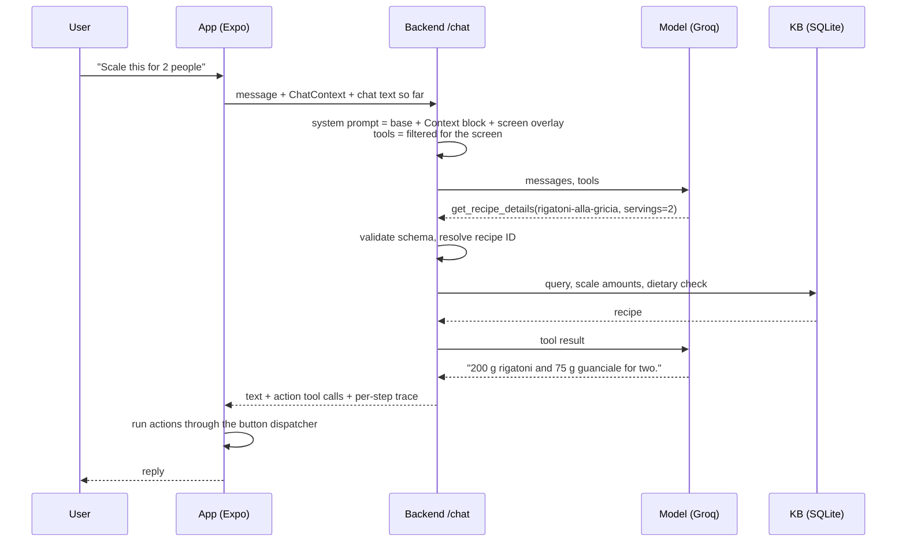

# Architecture

The README gives the overview. This file covers how one turn moves through the system: what the app sends, how the backend builds the prompt, how the agent loop runs, and where each check sits.

## One turn

## 1. Context injection
The server is stateless. The app owns all state and sends a fresh slice with every message (`ChatContext` in `pastaio-backend/app/schemas/chat.py`, built by `pastaio-app/src/services/buildChatContext.ts`):

| Field | Why the model needs it |
|---|---|
| `current_screen` | Picks the tool subset and the screen overlay in the prompt. |
| `active_recipe_id` | "That recipe" and "it" refer to this. The app resolves the reference before sending, so the model copies an ID instead of guessing one. |
| `active_shape` | The result of the last photo identification. |
| `current_step`, `active_timers` | Cooking mode: "how long is left?", "set a timer for this step". |
| `dietary_restrictions` | Rendered as `(HARD)`. The backend also enforces them in code (section 4). |
| `user_observations`, `recent_cooking_history` | Soft preferences for suggestions on the home screen. |

`render_context_block` (`app/services/prompts.py`) writes only the fields that are set, so the model is never shown an empty field it could fill in. Facts that apply to every turn are context, not tools: making them tools would spend a model call on fetching them.

The system prompt is built for every turn from three parts: a base prompt (tool-use mechanics, recipe-ID rules, groundedness, retrieval, memory and response style), the Context block, and an overlay for the home, recipe or cooking screen. `PROMPT_VERSION` is in the code, so prompt changes show up in git diffs.

## 2. Tool filtering
There are 14 tools. `app/services/tool_filter.py` sends only those that fit the screen:
- **Always:** search, details, open, save, restrictions, observations, identify, cookbook, start cooking.
- **With a recipe in scope:** substitution options, apply substitution, rating.
- **Cooking only:** `set_timer`, `end_cooking`.
- **Unknown screen:** everything, because a model without the right tool can't call it.

This keeps tool definitions at 1.1–1.9k tokens per call instead of about 3k, and it removes wrong options such as `set_timer` on the home screen.

## 3. The agent loop
`handle_chat` in `app/services/chat_service.py` runs at most `MAX_STEPS = 4` model calls per turn. Each tool call the model makes goes through these steps in order:

1. **Schema check.** `validate_tool_call` parses the arguments into the tool's Pydantic model.
2. **Recipe ID check.** `kb.resolve_recipe_id` rewrites a near miss (`trofie-pesto-genovese` → `trofie-al-pesto`) to the single real ID it matches, or rejects it. For substitution options the ID is optional, so a bad one is dropped instead.
3. **Data tool.** `find_recipes`, `get_recipe_details` and `get_substitution_options` run here against the KB, with dietary restrictions applied as filters. The results go back to the model as `tool` messages.
4. **Diet guard.** `apply_substitution` with a replacement that breaks a restriction becomes an error for the model, so it never reaches the app.
5. **Action tool.** Anything else is collected for the app. The model is told it was handed over. Opening or cooking a recipe that conflicts with a restriction is allowed, but the reply comes back with the conflicting ingredients and an instruction to warn the user.

After each model call the loop decides what happens next:

| Situation | What the loop does |
|---|---|
| A data tool ran, or an opened recipe conflicts | Feed the results back and call the model again. |
| A call was invalid | Feed the error back once (one repair attempt). After that, invalid calls are dropped. |
| The model says "the KB doesn't record that" without a lookup this turn | Send it back once with an instruction to look it up first. |
| Every `find_recipes` this turn came back empty, but the answer lists dishes that aren't KB titles | Send it back once; on the last step, replace it with the shapes the KB covers. |
| The text is a tool call written out (`<tool_call>…`) | Treat it as empty. |
| The answer is empty | Ask once more, without tools, so the turn ends in text. |
| Last step | No tools are offered, so the model has to answer. |

The response carries the text, the action calls, and a trace: one entry per model call with latency, token counts, and each tool call with its status (`ok`, `action` or `error`). Tests and the eval harness assert against the trace.

## 4. Dietary rules
`app/services/diet.py` reads two KB tables: `ingredient_classes` (guanciale → pork, pecorino → dairy, and so on) and `restriction_classes` (which classes each restriction forbids). The KB build fails if a recipe ingredient has no class. A name the KB doesn't know, for example a replacement the model suggests, counts as a conflict, so the check fails closed. Custom free-text restrictions ("no garlic") can't be checked against classes, so they stay with the model.

## 5. Model client
`app/clients/groq_client.py` adapts Groq's OpenAI-compatible API:
- **Schemas.** Tool schemas lose titles and defaults, and optional fields stay nullable, because `gpt-oss` sends `null` for optional arguments it doesn't use.
- **Fallback chain.** On a rate limit, the client moves to the next model (`qwen3.8-27b` → `gpt-oss-120b` → `gpt-oss-20b`). It waits once only when every model is under a short per-minute limit; a daily cap returns a 503.
- **Rejected calls.** If Groq rejects a generation because the model called a tool it wasn't offered (`tool_use_failed`), the client samples again with a hint, then tries the next model.
- **Reasoning.** It is off where the model allows (`none` for Qwen, `low` for gpt-oss), because the models dispatched tools worse with reasoning on.

The Ollama client and the offline stub implement the same interface (`app/clients/base.py`). The tests use fake clients, so CI runs without any model.

## 6. Vision
`POST /identify` sends one image to `qwen3.8-27b` with a prompt that lists the KB's shapes and allows `unknown` for anything else (penne, non-pasta, text in the image). The answer is constrained JSON: shape, confidence, and up to two alternatives that the app shows as "or maybe". Uploads are capped at 4 MB, below Vercel's 4.5 MB body limit.

## 7. The app side
`pastaio-app/src/services/toolDispatcher.ts` runs action tools with the same store actions and router calls the buttons use. When the agent "saves to cookbook", it goes through the same code path as a tap on the bookmark. Memory, the cookbook and cooking history live in on-device SQLite. The app also ships a copy of the KB for browsing, so only chat and vision need the backend.

## 8. The knowledge base
`pastaio-kb/source/*.yaml` holds the recipes, shapes, sauces, regions and ingredient classes, each fact with its source (rules in `pastaio-kb/RESEARCH_PRINCIPLES.md`). `build.py` validates them with Pydantic and compiles one SQLite file, which goes to both the backend and the app. CI rebuilds it and fails if the committed database differs from the YAML.

## 9. Evaluation
`pastaio-eval/` runs scripted multi-turn conversations against `/chat`. It mirrors the app's dispatcher, stores and context builder in Python, so it needs no phone or simulator, and it scores each turn against assertions on tool calls, arguments, resulting state and reply text. `compare.py` checks the guarantees above against the same model without tools or KB. See `pastaio-eval/README.md`.
